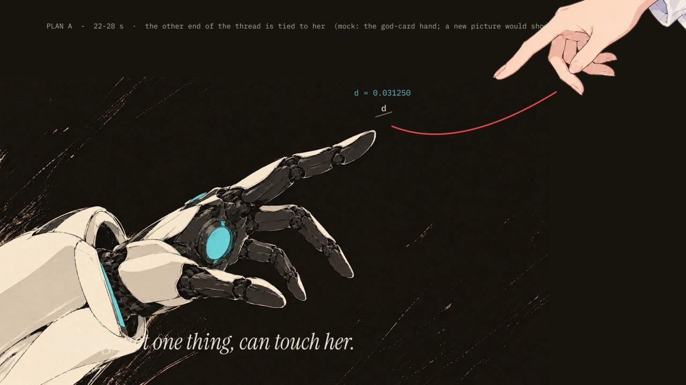
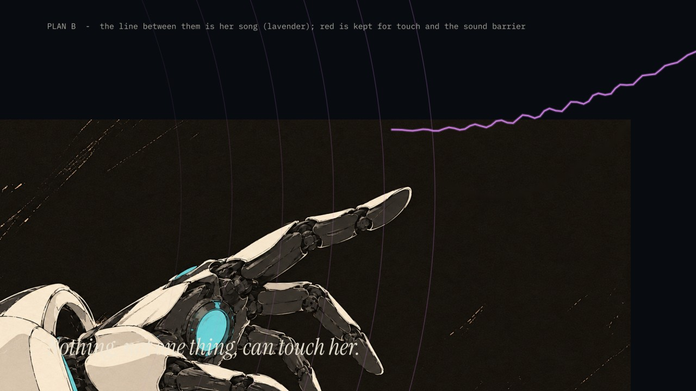
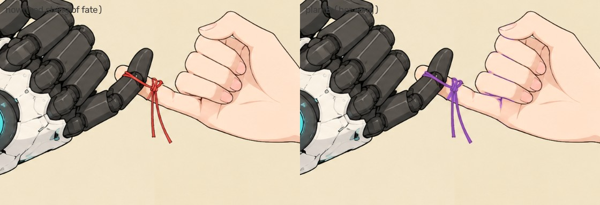

# 红线：两个方案（2026-10-18）

**问题：** 22.5–28 秒是纯伴奏，现在的画面是：她伸出机械手指，指尖前面飘着一截红线头；镜头每拍放大一倍（芝诺），`d` 每次减半，但永远碰不到；字幕是洛菈米亚初版卡上实验室笔记的那句 "Nothing, not one thing, can touch her."（什么都碰不到她）。

它想说的是"她最快，所以什么都碰不到她"，并为 56 秒红线缠上手指、57 秒勾小指、207 秒 `touch = true` 做铺垫。可画面里**没有里榭娜**，红线头也**不知道从哪来、连向谁**，所以看起来意义不明。

示意图在 [`gen/_qa/redline_mock/`](gen/_qa/redline_mock/)，只是拼出来的草图，不是成片画面。

红线在全片出现的地方：22–28 线头，56 秒缠上手指、进入核心，57 秒勾小指（之后作为窗口、碎片、倒带反复出现），112–116 秒"you have left"里落下，160 秒穿过牢笼被拉直、起跑，186–192 秒心形，结尾 `touch = true`。

---

## 方案一：只改 22–28 秒 —— 线的另一头是她

**一句话：** 红线不再是一截不知来历的线头，而是**另一头系在里榭娜小指上的那根线**。"什么都碰不到她"，包括她最想碰的那一个。

| 时间 | 画面 |
|---|---|
| 22.5 | 从 LIGHT 的白闪里出来：左下是她伸出的机械手指（原图），**右上是里榭娜伸过来的手**，红线一头系在里榭娜的小指上，松松地垂向洛菈米亚的指尖 |
| 23–24.3 | "Nothing, not one thing," 一个词一拍；`d` 的标注出现在指尖和线头之间 |
| 24.3–27.1 | 芝诺：每拍放大一倍，`d` 每拍减半；每一层放大里都还看得见两只手和中间那根线，就是永远差一点 |
| 27.1–28 | 拉回全景，"can touch her."，`d ≠ 0`；接 28 秒标题 `world.execute(me);` |

- **改动：** 只有 `scenes2.s_gap` / `s_zeno` / `s_near` 三个镜头。56 秒以后的红线全部不动，而且有了来历：56 秒缠上的、57 秒勾住的，就是 22 秒那根线。
- **生图：** 1 张（L16）：里榭娜的手从右上方伸下来，小指上系着红线的一头，墨底透明 PNG，画风同神卡的手。没有这张就用神卡那只手旋转代替（示意图就是这么拼的，指头不对）。
- **重渲：** 22–28 秒，以及用到碎片的桥段和尾奏（碎片会取样 22–28 秒）。

---

## 方案二：全片 —— 那根线就是她的歌

**一句话：** 第二版的主线是"光与声"：她比声音快，可歌追得上她。那么两人之间的那根线**不该是红线，而该是里榭娜的歌**：一根会振动、带着旋律的弦（弦振动就是声音）。

**颜色规则随之改变：**

| 颜色 | 现在 | 方案二 |
|---|---|---|
| 青 | 她的核心、系统、能量 | 不变 |
| 兰紫 | 只给里榭娜的歌声 | 歌声，**以及两人之间的那根线**（线就是歌） |
| 红 | 红线、touch、音障 | **只剩 touch 和音障**：19 秒她撞破的音障，和结尾那一行 `touch = true`。全片的红色从"一直都在"变成"只在开头被撞破、在结尾终于成立" |

**逐段改动：**

| 时间 | 现在 | 方案二 |
|---|---|---|
| 22.5–28 | 指尖前一截红线头 | 她冲过音速以后，空气里的歌全被甩在身后（15–22 秒的兰紫波前）；只剩一根兰紫的弦系在她小指上，还在**随旋律振动**：她甩得开空气里的声音，甩不开系在身上的这一根。芝诺：她沿着弦往前够，永远够不到另一头 |
| 56–59 unite / deeply | 红线缠上手指、接进核心（core · bound） | 兰紫的弦缠上手指、**接进她的核心**：歌被接进了她的心脏。字改成 `core · tuned` 之类 |
| 57 勾小指（及之后所有窗口、碎片、倒带） | 画好的红绳结 | 绳结改成兰紫（代码里对红色像素换色，见下图；效果不好再请 GPT 重画） |
| 105 VIBRATIONS | 兰紫旋律线从她唇边到洛菈米亚耳边 | 不变，但现在一眼看得出：**这条旋律线就是那根弦** |
| 112–116 you have left | 红线落下 | 弦落下、停止振动（歌停了） |
| 160 拉直、起跑 | 红线穿过牢笼被拉直 | 弦被拉直，**开始振动**：歌回来了，她顺着歌的方向起跑 |
| 186–192 心形 | 红线描出心形 | 弦描出心形，随旋律颤动 |
| 结尾 | 勾小指 + `touch = true`（红） | 两人勾着的小指间一小圈兰紫的弦（代码画）；`touch = true` 仍是全片最后的红色 |

- **代价：** "红线"是一看就懂的命运红线；改成兰紫以后，这个现成的符号没有了，要靠 15–28 秒和 105 秒把"线 = 歌"讲清楚。好处是第二版的"光与声"会从头贯穿到尾，红色也有了更干净的意义。
- **改动：** 大约 8 个镜头（`scenes2/3/4/5/6/7`）、`prep7.py` 给画好的红绳结换色、`CLAUDE.md` 的颜色规则。
- **生图：** 0 张（先试换色）；如果换色后的绳结不好看，再请 GPT 重画 3 张（勾小指、独手、缠线的手）。
- **重渲：** 整片。

---

## 我的建议

我倾向**方案二**：第二版的主题本来就是"歌追上了比声音还快的她"，让那根线就是歌，22–28 秒就不再是孤立的一段，56 秒、105 秒、160 秒也会连成一条线。但它改动大，而且放弃了"命运红线"这个人人都懂的符号；如果你更看重那个符号，方案一更稳。

请选一个（或者说说想怎么混搭）。
