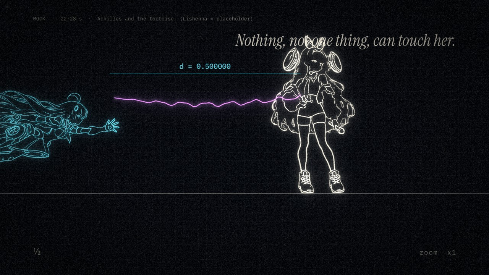
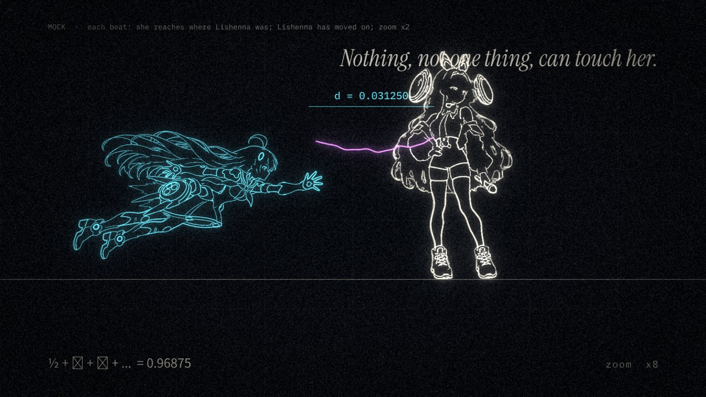

# 第二版 · 第六轮：22–28 秒重做 + 全片复查（2026-10-19）

我按 0.25 秒一张，把 `round5` 的 27 张验收拼图从头到尾看了一遍。下面先写 22–28 秒的新方案（你点名的），再写我自己挑出来的问题，按轻重排。

---

## 一、22–28 秒：阿基里斯追不上乌龟

**问题：** 用"手指 + 线头"去讲"碰不到"，画面里只有一只手，太抽象，人物没有参与。

**新想法：** 现在这段用的是芝诺悖论里的"二分法"（距离每次减半）。芝诺最有名的其实是另一个：**阿基里斯与乌龟**——世界上跑得最快的人，永远追不上前面慢吞吞的乌龟：每次他跑到乌龟刚才的位置，乌龟又往前挪了一点。

这几乎就是这对 CP：刚刚冲破光速的洛菈米亚，追不上前面**悠闲地边走边唱**的里榭娜。字幕 "Nothing, not one thing, can touch her."（官方实验室笔记）从"什么都碰不到她"变成了反讽：她最快，却碰不到最慢的那一个。

**画风：** 和 39–48 秒一样，用示波器式的荧光线稿（你说 AC/DC 那段好看）：洛菈米亚是青色，里榭娜是骨白色，两人之间那根兰紫的弦就是她的歌。

| 拍 | 时间 | 画面 |
|---|---|---|
| k48 | 22.5 | 从 RIVALS LIGHT 的白闪里出来，网格背景、一条地平线。右边里榭娜侧身往右边走边唱，弦从她的话筒拖向身后；左边远处，洛菈米亚（18 秒那张飞行图的线稿）伸着手冲过来。"Nothing," |
| k49–51 | 23–24 | 每拍：洛菈米亚一瞬间冲到里榭娜**刚才**的位置；里榭娜这一拍又迈了一小步。`d = 0.5 → 0.25`。"not one thing," |
| k52–56 | 24.3–26.2 | 芝诺加速：每拍冲一次、镜头放大一倍（网格变细，人物大小不变），画面一模一样地重复；底部打出 `½ + 1/4 + 1/8 + … = 0.96875`，永远到不了 1。"can touch her." |
| k56 | 26.2 | 保留现在的半拍定格：只有弦在抖 |
| k58–60 | 27.1–28 | 洛菈米亚的指尖停在里榭娜身后一点点的地方（弦的末端就在她指尖前），`d ≠ 0`；接 28 秒标题 |

示意图（里榭娜暂时用站姿图镜像代替）：[`gen/_qa/achilles_mock/`](gen/_qa/achilles_mock/)

**生图：** 2 张（见 [`gen/request_v2d.md`](gen/request_v2d.md)），里榭娜**侧面朝右、边走边唱**的全身，A/B 两步交替就是走路。没有这两张，就用站姿镜像（像示意图那样，她不走，只站着唱）。

**联动：** 22–28 秒在碎片取样范围里，改了以后碎片和桥段、尾奏要重做，等于整片重渲。

---

## 二、我自己挑出来的问题

### 必须修

1. **黑板上缺字（179–181 秒）：** 公式 `Σ ½ⁿ = 1` 里的上标 ⁿ，数学字体里没有，显示成一个方块。第一版就有这个错。改成 `Σ (1/2)^n = 1` 的上标排版。
2. **192 秒的 LOVE 压在里榭娜腿上：** 舞台那一镜最后一个 LOVE 打在画面下方正中，正好盖住她的腿。挪到左下角的观众区（和 SATISFACTION 一样）。

### 建议改

3. **133–148 秒间奏，"孵化"看不出来：** 设计是"每加一档速度，冲过来的窗口里她的画面就更多"，但实际上前 10 秒几乎全是洛菈米亚的画面（窗口池里她的图重复太多），到 145 秒才突然全变成里榭娜。改成：第一档就有零星几张她，每档明显增加；有她的窗口标题栏换成兰紫，一眼看得出哪些是她。
4. **63–66 秒舞台，里榭娜太小：** 她只占画面三分之一，表情看不清。改成演唱会的"大屏直播"：唱到 SATISFACTION 那一拍，中间巨屏切成她的脸部特写（设定图的脸），两侧屏幕继续放洛菈米亚做的模拟。台上小小的她和屏幕上大大的她同时出现，也更像真实的演唱会。
5. **192–196 秒尾奏开头，环绕的窗口里没有她：** 这一圈窗口是"全片的回忆"，现在全是洛菈米亚。加进几张有里榭娜的（勾小指、崖边、立方体合照）。
6. **205–207 秒撕纸以后，裂口外的歌太淡：** 兰紫声波细得几乎看不见，"她朝着歌跑过去"这个意思没传达出来。把裂口外的声波加粗、加亮，并且每拍一圈；裂口外的光从纯白改成暖白。

### 我注意到、但建议先不动的

- **198–201 秒：** 立方体散开后，她在画面中央停了大约 3 秒，只有圆环在动。这是"剥层"的节奏，下一层撕开时会动起来；改动会牵动整段，先不碰。
- **卡点统计：** 59% 的硬切在 35 毫秒以内（第一版是 63%）。多出来的偏离主要是有意加的"拍后动作"（门弹开、戳滑落等），不是错拍。

---

## 需要你决定

1. 22–28 秒用"阿基里斯追不上乌龟"，可以吗？
2. 第二节第 3–6 条建议改的，要不要一起做？（第 1、2 条是错误，我会直接修。）
3. 生图需求 [`gen/request_v2d.md`](gen/request_v2d.md) 2 张，请转给 GPT。
