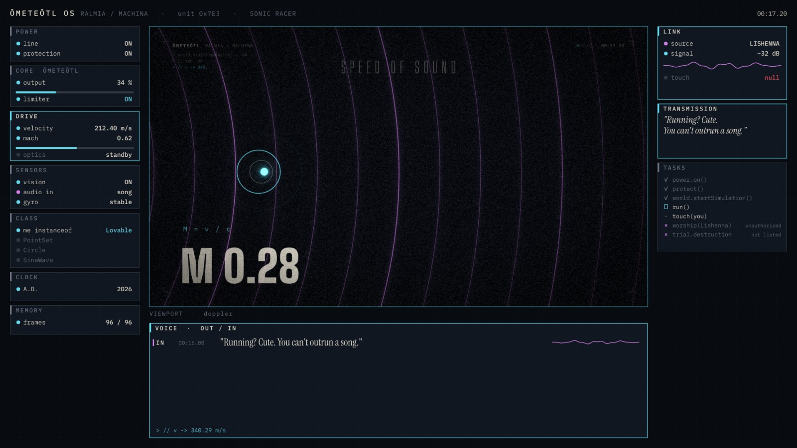
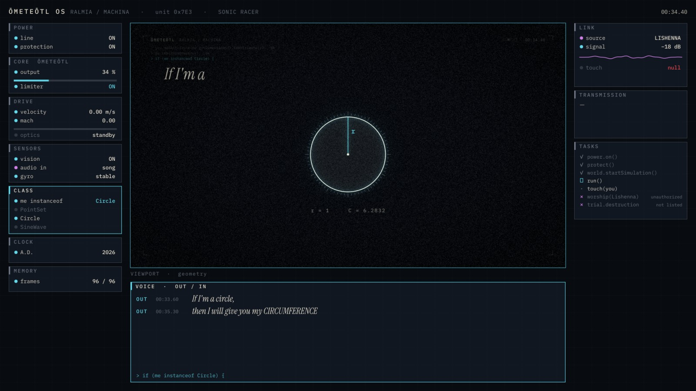
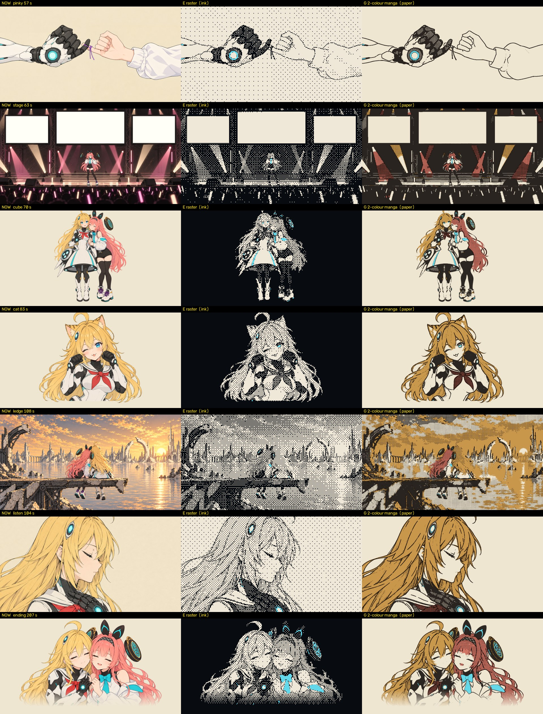
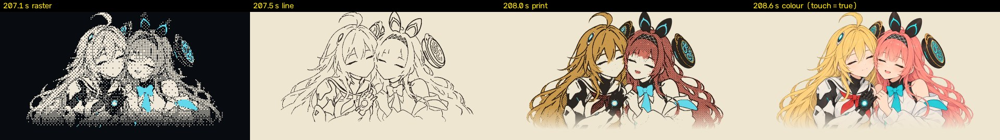

# 第三版方案：她的机体系统（2026-10-20）

依据：参考片分析 [`ref_BV186pc65E68.md`](ref_BV186pc65E68.md) 和你的 8 条回复。v3 从第二版第七轮出发，**镜头、叙事、节拍基本保留**，变化有三处：

1. 外面套一层**洛菈米亚的机体系统**当作全片的舞台；
2. **里榭娜开口说话**，成为第二个声音；
3. 所有 GPT 图**统一画风**。

示意图在 [`gen/_qa/v3_mock/`](gen/_qa/v3_mock/)，都是用现有成片画面拼的草图。

---

## 一、主线：一台机器从开机到关机

v2 讲的是"她比声音快，却被一首歌追上"。v3 换一个视角来讲同一件事：**观众看到的是她的系统**。

开机（0 秒）→ 运行 → 里榭娜的歌一点点渗进系统（兰紫色从无到有）→ 破坏的试炼把系统一个模块一个模块地处决 → 解除核心限制，系统崩溃，**以《宙之翼》形态重启**（官方卡就是这样：她通过破坏的试炼，进化成アストロウィング）→ 最后她亲手把系统一个个关掉，关掉 protection，撕开纸，碰到她。

---

## 二、机体系统面板：ŌMETEŌTL OS



**布局**（1920×1080）

| 区域 | 内容 |
|---|---|
| 顶栏 | `ŌMETEŌTL OS · RALMIA / MACHINA · SONIC RACER`（形态名，重启后变成 `ASTROWING`）、时间码、节拍灯 |
| 左栏：她的身体 | **POWER**（电源线、protection）、**CORE**（输出、核心限制器）、**DRIVE**（速度、马赫、光学机动）、**SENSORS**（vision、audio in、gyro）、**CLASS**（`me instanceof …`）、**CLOCK**、**MEMORY** |
| 中间：VIEWPORT | 现在的各个镜头都放在这里 |
| 右栏：她的外面 | **LINK**（信号源 LISHENNA、信号强度、touch 字段）、**TRANSMISSION**（里榭娜说的话）、**TASKS**（任务清单，见第五节） |
| 底部：VOICE | 语音记录：OUT = 洛菈米亚唱的（歌词），IN = 里榭娜说的 |

**两种模式交替**，避免全片都是"界面"：

- **面板模式：** 主歌、讲系统的段落（0–60 秒、主歌 2、切换段、桥段、试炼段）。镜头缩进 VIEWPORT，四周的模块随拍动：灯每拍闪一下，数值跳动，当前关键词对应的那个模块亮起、展开。
- **全屏模式：** 副歌、情感镜头（勾小指、舞台、崖边、副歌 3、LOVE、结尾），面板向四边滑开，画面铺满。切换都卡在小节线上。

**颜色：** 面板本身只有墨、骨白、青（她的系统）。**兰紫随剧情渗进来**：

| 时间 | 兰紫在面板上的样子 |
|---|---|
| 开头 | 只有 LINK 模块的波形 |
| 105 秒 VIBRATIONS | audio in 被她的声音占满 |
| 间奏 | 模块边框一个个变成兰紫，`data.corrupted 12% → 88%` |
| 试炼段 | 只剩 LINK 还亮着 |
| 重启后的 ASTROWING | 兰紫成为系统的正式颜色之一 |

红色仍然只给 touch 和音障。

**实现要点：**

- 歌词从镜头里搬进 VOICE 记录，镜头里只留大字关键词，这样就不是"字幕"了；
- 原来角落里的 HUD 并进顶栏和 VOICE；
- 镜头本身的代码基本不用改。

---

## 三、里榭娜开口：第二个声音

**形式：** 不是聊天气泡，是她这台机器收到的**外部信号**。TRANSMISSION 模块打出文字（骨白色），旁边一条兰紫波形；VOICE 记录里同时记一行 `IN`。只在歌词空档出现，全片约 14 句，多数是英文短句（全片的文字都是英文），中文是给你看的翻译。

| # | 时间 | IN（英文） | 中文 | 出处 |
|---|---|---|---|---|
| 1 | 16.8 | "Running? Cute. You can't outrun a song." | 跑起来了？真可爱。你跑不过歌的。 | 《音速の突破》里榭娜的台词 |
| 2 | 20.5 | "…hey. Where'd you go?" | 喂，你跑哪去了？ | 原创（破音障，把歌甩在身后） |
| 3 | 23.0 | "Catch me~" | 来抓我呀～ | 原创（阿基里斯与乌龟） |
| 4 | 57.5 | "Promise." | 说好了。 | 原创（勾小指） |
| 5 | 63.0 | "Eyes on me." | 看着我。 | 《破壊の絶傑》："你的眼睛离不开我" |
| 6 | 66.4 | "Not bad — for a machine." | 对机器来说，还不错嘛。 | 原创（SATISFACTION） |
| 7 | 70.5 | "Trapped? With me? Lucky you." | 被关住了？和我一起？你赚到了。 | 原创（立方体合照） |
| 8 | 86.1 | "Then kneel." | 那就跪下吧。 | 《破壊の絶傑》："所有人都跪下来向偶像祈祷" |
| 9 | 111.5 | "Show's over~" | 演出结束啦～ | "奏绝"：演奏中断 |
| 10 | 127.5 | "Refuse me? Too late." | 想拒绝我？太迟了。 | 《奏絶の顕現》："拒绝已经太迟了" |
| 11 | 133–148 | （无，TRANSMISSION 显示 `— no signal —`） | 歌停了 | "奏绝"：沉默里孵化崇拜 |
| 12 | 148.0 | "Break everything. Except me." | 把一切都毁掉吧，除了我。 | 《奏絶の破壊》："除了我，全都毁掉吧" |
| 13 | 172.0 | "…you came back." | ……你回来了。 | 原创（倒带回到勾小指） |
| 14 | 190.0 | "Sing with me." | 和我一起唱吧。 | 原创（you are free） |
| 15 | 结尾 | （只有波形，`me.hum();`） | | |

洛菈米亚自己的回答不进 VOICE（VOICE OUT 只放歌词），放在 TASKS 和代码行里，用的是《宙之翼》卡面：

- `worship(Lishenna)  × unauthorized`：崇拜没有授权；
- `trial.destruction  × not listed`：破坏的试炼，不知道；
- k350 `me.isBreakable() == false`、k351 `me.releaseCoreLimit()`（这两行 v2 已有）；
- 重启后 `optics: sublimated`（光学机动，升华完成）；
- LOVE 段 `receive(song)  ✓`：她没有崇拜，但"不让歌停下，接住了它"。

---

## 四、关键词落在部件上

以歌曲自己的代码（GodDrinksJava）为依据。原代码里就有 `me instanceof PointSet / Circle / SineWave / Sequence / Eggplant / Tomato / TabbyCat`，所以 **CLASS 模块**是全片最自然的双关：她变成什么，模块就切到什么。



| 时间 | 歌词 | 落在哪个部件上 |
|---|---|---|
| 0–1.8 | power line | POWER：line 开关打开，面板从黑屏亮起 |
| 1.8–3.7 | PROTECTION | POWER：protection 开关打开 |
| 3.7–5.5 | PIECES | **面板自己的模块飞进来拼好**（v2 的零件落位，换成面板模块） |
| 5.5–7.4 | OBJECT CREATION | CLASS：`me = new Lovable("Me", 0, true, -1, false)` |
| 7.6–9.7 | DATA | MEMORY 被数据填满 |
| 9.7–11 | INITIALIZATION | SENSORS：vision 打开，VIEWPORT 里睁眼（v2 的睁眼镜头） |
| 11–14.8 | WORLD / SIMULATION | VIEWPORT 显示纸世界，模拟计数 |
| 15–22.5 | （伴奏）音速 | DRIVE：速度、马赫数，音障是红色；TRANSMISSION #1、#2 |
| 22.5–28 | （伴奏）阿基里斯 | LINK 改为**目标锁定**：`target: LISHENNA  d = …  lock: failed` |
| 28 | world.execute(me); | 在 VOICE 里敲出这行命令 |
| 30–48 | points / dimension / circle / sine / infinity | CLASS 依次切换：PointSet → Polyhedron → Circle → SineWave → Sequence |
| 44–48 | switch my current to AC / DC | POWER：电流 AC ↔ DC（v3 的示波器镜头已经在 VIEWPORT 里） |
| 48–50 | blind my vision | SENSORS：vision OFF，VIEWPORT 变成雪花 |
| 50–52 | dizzy | SENSORS：gyro 乱转，整个面板倾斜 |
| 52–55 | A.D. 617 → B.C. 3691 | CLOCK 倒拨（她的系统时钟） |
| 55–56 | unite | LINK：handshake 建立，`touch: null → true`（红） |
| 57–59 | so deeply | CORE：她的歌接进核心，`core · tuned` |
| 59–74 | 副歌 1 | 全屏 |
| 74–89 | eggplant / tomato / cat / god | CLASS：Eggplant → Tomato → TabbyCat → God；标本卡的数据栏搬进面板 |
| 89–100 | F/M、AM/PM、S/M | 现有的拨动开关（v2 已经是"开关"的画法），放进面板；AM/PM 接 CLOCK |
| 100–104 | trance | SENSORS：audio in 全是她的哼唱 |
| 104–107 | VIBRATIONS | 全屏，两张侧脸 |
| 111–118 | you have left ×6 | LINK：`signal lost`，下面计时 `last packet: 3 s / 1 min / 1 h / 1 day…`，六次离开各跳一档 |
| 118–126 | FRAGMENTS | MEMORY：删记忆，`Permission denied` |
| 126–133 | Challenging your god | 全屏（代码神像） |
| 133–148 | 间奏 | 第一人称走廊在 VIEWPORT 里，模块边框一个个变兰紫 |
| 148–163 | 试炼段 | 见第五、六节 |
| 163–212 | 副歌 3、LOVE、尾奏 | 以 ASTROWING 形态重启，见第五节 |

---

## 五、首尾呼应 + 剧情弧线

**开机（0–15 秒）↔ 关机（192–205 秒），顺序正好相反：**

| 开机 | 关机（尾奏，每小节关一个） |
|---|---|
| POWER line ON | VIEWPORT 关闭 |
| **protection ON（2.5 秒）** | SENSORS OFF |
| 模块拼装 | DRIVE OFF |
| CLASS `new Lovable` | 模块拆散飞走（v2 的剥层改成拆面板） |
| vision ON（睁眼） | **protection OFF（约 203.5 秒）**：歌词开头那句 "Remember to put on PROTECTION"，到结尾她自己把它关掉，才碰得到对方 |
| | 她冲出、撕纸、贴贴（v2 原样） |

`touch` 字段全片的变化：9.95 秒 `null` → 56 秒 `true` → 112 秒变回 `null`（she left）→ 结尾 `touch = true`。这条线 v2 里已经有，v3 放在 LINK 模块里一直看得见。

**TASKS 任务清单，一条贯穿全片的线：**

```
✓ power.on()
✓ protect()
✓ world.startSimulation()
▶ run()
· touch(you)                d → 0      ← 22–28 秒一直失败；56 秒成功；112 秒变回失败
× worship(Lishenna)         unauthorized
× trial.destruction         not listed  ← 148 秒被强行插入，变成 ▶ 01/12 … 12/12
```

结尾全部关掉以后，只剩 `✓ touch(you)`。

---

## 六、计数要看得清：破坏的试炼

148–158 秒 12 声 EXECUTION：v2 的走廊和门（以及"戳盖不到她"）保留在 VIEWPORT 里，同时**每一声处决面板上的一个模块**：

- 左栏从上往下、右栏接着，一声一个模块：盖 EXECUTED 戳、变暗、掉下去；
- 顶部一条 12 格计数条 `TRIAL 07 / 12`，大字；
- **LINK 模块盖不上戳**，它是她的（"不会被效果破坏"）；12 声以后，面板上只剩 CORE 和 LINK；
- 第 13 声 EXECUTION（162.4 秒）：计数条只有 12 格，显示 `13 > 12  OVERFLOW`，CORE 被锁成牢笼（v2 的六边形牢笼）；
- `releaseCoreLimit()` → 系统崩溃、白闪（v2 的 162.8 秒白闪）→ **以 ASTROWING 重启**：顶栏形态名改变，面板以新的配色（青 + 兰紫）重新拼起来。

---

## 七、剪辑节奏：把高峰挪到副歌 3

你说不用顾虑光敏，那就按好看来排。目标：

| 段落 | v2 硬切 | v3 目标 | 做法 |
|---|---:|---:|---|
| 间奏 133–148 | 56 | 约 12 | 去掉窗口频闪，只留每 8 拍一次换挡；"歌停了"应该是屏住呼吸的感觉 |
| 试炼段 148–163 | 58 | 约 30 | 12 声处决、12 次撞门、报数 6、第 13 声；去掉其余闪光 |
| **副歌 3 163–177** | 24 | **约 60** | 见下 |
| LOVE 177–192 | 12 | 约 15 | 不变 |

**副歌 3 的新做法：**

- 163–166 秒：重启后的第一小节，每个八分音符硬切到一个刚恢复的模块。
- 169–171 秒倒带：用**全片本身的画面**，按十六分音符倒着闪回，从 160 秒一路闪到 57 秒的勾小指，大约 30 次硬切，落在 "back" 那一拍。
- 172–177 秒：伸手、画中画，保持 v2 的样子。

这样全片的剪辑高峰正好落在"把你找回来"这一句上。

---

## 八、统一画风（修订：我选定的方案）

我们依赖 GPT 图，而 GPT 图风格不一。v3 让**每一张图在入库时就统一处理**，不再直接用原图。

我一共试了 6 种：屏幕线稿、套色印刷、漫画网点、双色 riso、1-bit 点阵、平涂海报。对照图见 [treatments.jpg](gen/_qa/v3_mock/treatments.jpg)、[treatments2.jpg](gen/_qa/v3_mock/treatments2.jpg)。

**选定：两种"介质"，直接跟着现有的纸底 / 墨底规则走；全彩只留给结尾。**



| 底色 | 介质 | 样子 | 为什么 |
|---|---|---|---|
| **墨底**（系统、运行） | **机器的显示屏** | 图片用 **1-bit 点阵**（骨白 / 墨，有序抖动，像素略粗），她核心的青色保留；图表、几何、示波器、22–48 秒的人物用**矢量荧光线稿**（就是你喜欢的 AC/DC 那种） | 机器看到的世界就是这样：图像是光栅点阵，数据是矢量线。面板本身是清晰的矢量 UI，图片是点阵，一眼看得出"这是她的传感器看到的" |
| **纸底**（她造的世界、回忆、和里榭娜在一起） | **双色漫画印刷** | 黑墨线 + 网点，外加**每个角色一种专色**：洛菈米亚的头发是赭金，里榭娜的头发是珊瑚红；套印略有错位 | 回忆像一页漫画，又暖又统一；双色保住了两人的辨识度。单色漫画会让两个人的头发变成一样的白 |
| **全彩** | GPT 原图 | 只在结尾 | 见下 |

**结尾四步走完全片的画风**（208–209 秒，贴贴那一下）：



点阵（系统看到她）→ 线稿 → 双色印刷（回忆）→ 全彩（`touch = true`）。全片只有这里是全彩，"碰到了"就是颜色终于来了。

**没选的几种：**

- **套色印刷**和**平涂海报**：好看，但和双色漫画是同一类，网点和墨线让双色漫画更有质感；
- **双色 riso**：两种墨让两个人的头发都变成橙色，认不出谁是谁；
- **单色漫画**：同样的问题，两个人的头发都变白；
- **屏幕线稿**用在背景复杂的场景（舞台、崖边）上太碎，所以只用在人物和图表上。

**代价：** GPT 图的光影细节会少很多，这是统一画风必须付的代价。

**实现：** `prep` 给每张图生成 `_r`（点阵）和 `_m`（双色漫画）两个版本；`surf()` 读图时按镜头的底色自动换成对应版本，镜头代码不用改。结尾的四步单独写。

这一版**不需要新的生图**。

## 九、B 站简介（光敏提示放在这里，不改开头）

草稿见 [`bilibili_description.md`](bilibili_description.md)。闪烁的时间段等成片出来后再按实际填。

---

## 九·五、复用多少

| 角度 | 复用 | 说明 |
|---|---|---|
| **画面时长** | 约 **70%** | 15–133 秒、166–169 秒、171–177 秒、LOVE 段、撕纸和贴贴，镜头本身原样放进 VIEWPORT 或全屏，约 149 秒。要重做的约 63 秒：开机 0–15 秒、间奏和试炼段 133–163 秒、副歌 3 的两小段、尾奏关机 192–205 秒 |
| **代码** | 约 **85%** | v2 的镜头代码约 5500 行，基本不动，只把歌词、HUD 的调用改到面板上（各约 60 处）。新写约 1500–2000 行：面板约 800 行、面板状态时间线约 400 行、画风处理约 250 行、倒带、试炼、关机共约 400 行 |
| **素材** | **100%** | 全部 GPT 图照用（重新处理），不需要新图 |
| **看起来** | 约 **30%** 像 v2 | 面板和画风改变的是每一帧的外观，所以看起来会像一部新片 |

## 十、做法和顺序

一次做完风险太大，分三步，每步给你一段预览：

1. **样片（0–30 秒）：** 统一画风（prep）+ 面板框架 + 开机顺序 + 里榭娜的第 1–3 句。这一步最能看出 v3 成不成立。
2. **全片铺开：** 所有段落接进面板（面板 / 全屏切换、CLASS、LINK、TASKS、VOICE），台词表全部接上。
3. **剧情的大动作：** 试炼段处决模块、ASTROWING 重启、副歌 3 倒带蒙太奇、尾奏关机，然后整片渲染和验收。

## 需要你决定

1. 画风：墨底 = 点阵 / 矢量线稿，纸底 = 双色漫画，全彩只留给结尾。看对照图可以吗？
2. 面板模式和全屏模式交替的安排可以吗？
3. 里榭娜的台词表（英文为主），要改哪几句？
4. 新增的剧情："试炼把面板一个模块一个模块地处决，只剩 LINK"，以及"以 ASTROWING 重启"，可以吗？
5. 先做第一步的 0–30 秒样片？
