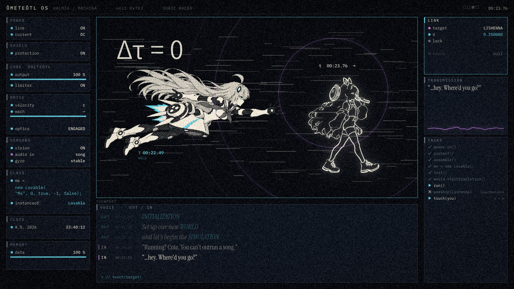
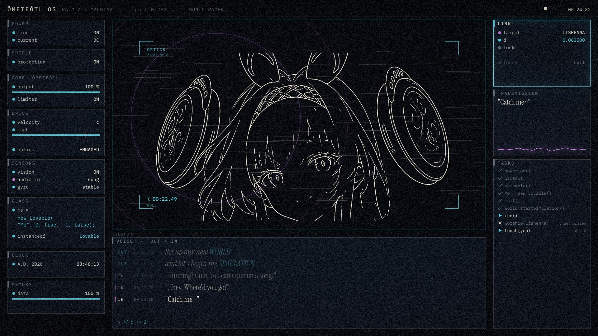
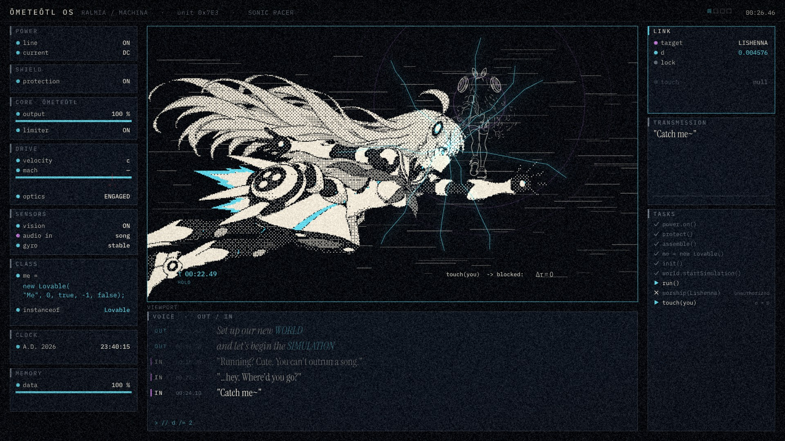
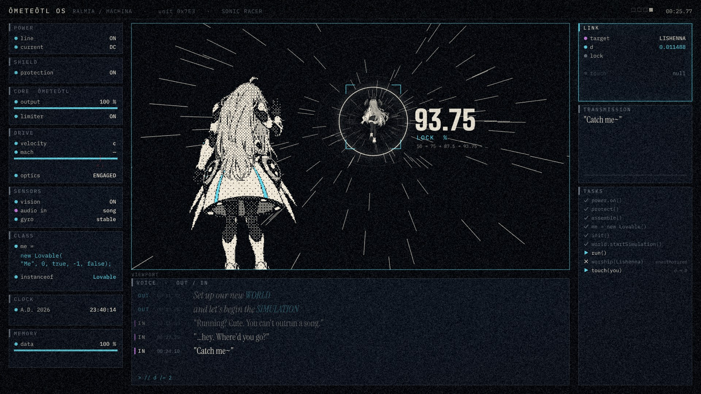
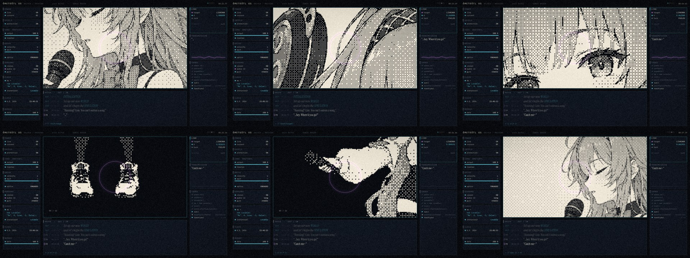

# 第三版 22.5–28 秒：换掉"阿基里斯追乌龟"（2026-10-20）

**问题：** 为了表现"快但追不上"，第二版让两人每拍跳一次位置，看着别扭；可要是只拍一个走、一个追，最快的机器追不上一个散步的人，又说不通。第三版以表现为先，所以这一段不再讲"追"。

**这一段的音乐**（k48–60，12 拍）：稳定的律动，没有停顿。每两拍有一次明显的重音，落在后半拍（k48.5、50.5、52.5…），一共 6 次，镜头就切在这 6 个点上。前面是 18.8–22.5 秒的"SWIFTER THAN SOUND / RIVALS LIGHT"（全屏，她到了光速），后面是 28 秒敲出 `world.execute(me);`。

下面三个方案的样帧都是用现有素材、套着真实面板拼出来的，只用来看构图。用户已经说可以随便让 GPT 生图，所以每个方案后面都写了要补哪些图。

---

## 方案 A（推荐）：到了光速，她的时间停了

**想法：** 跑得越快，自己的时钟走得越慢；到了光速，她自己的时间（固有时 τ）就停了。所以光速的洛菈米亚**整个停在半空**，整个世界里只有里榭娜和她的歌还在动。最快的机器不是"追不上"，而是被一个散步的人"抓住了"。这样就不用再解释"为什么追不上"。

**画法：** 停住的东西都用点阵（洛菈米亚、挂在空中的光线碎片）；还在动的只有两样：里榭娜（矢量线稿）和她的歌（兰紫色波纹）。面板也停住：数值不跳、节拍灯不闪、CLOCK 不走，顶栏写 `Δτ = 0`。只有 LINK 和 TRANSMISSION 还在动，因为那是她的歌。这也给后面试炼段的"LINK 不会被处决"埋了伏笔。

| 镜头 | 拍 | 秒 | 画面 | 台词 / 面板 |
|---|---|---|---|---|
| A0 | k48–48.5 | 22.49 | 从 LIGHT 的白光里出来，画面一下停住，白光退成点阵 | 面板滑回来时已经冻住，顶栏 `Δτ = 0` |
| A1 | k48.5–52.5 | 22.72 | 侧面全景：洛菈米亚停在冲刺的姿势里，光线碎片挂在空中。里榭娜从右边走进来（A/B 两步交替），停在她面前。两个时钟：`τ 00:22.49` 停着不动，`t` 一直在走 | IN："…hey. Where'd you go?"（22.75） |
| A2 | k52.5–54.5 | 24.57 | 两人近景：里榭娜弯着腰、手背在身后，凑近停住的洛菈米亚的脸看，不碰 | — |
| A3 | k54.5–56.5 | 25.49 | 洛菈米亚的视角：里榭娜凑到镜头前眨一只眼，四周是冻住的取景框 `OPTICS · frame held` | IN："Caught you."（新增：反过来是她抓住了洛菈米亚） |
| A4 | k56.5–58.5 | 26.42 | 里榭娜走开，回头挥手。前景是巨大的、停住的洛菈米亚，从她指尖开始裂出青色裂纹 | IN："Now catch me~"；TASKS `touch(you)  blocked: Δτ = 0` |
| A5 | k58.5–60 | 27.34 | 裂纹爬满画面，k59.5 碎掉，转白；28.03 秒敲出 `world.execute(me);`，时间重新走起来 | 标题之后面板恢复跳动 |

A2（两人近景）现有素材里没有，要等新图。

**要补的图（3 张必须 + 1 张可选）：** 见 [`gen/request_v3a.md`](gen/request_v3a.md)。

1. 两人近景：里榭娜凑近看停住的洛菈米亚（A2）；
2. 里榭娜对着镜头眨眼（A3）；
3. 里榭娜走开时回头挥手（A4）；
4. （可选）洛菈米亚冲刺的 3/4 正面，看得到脸。没有这张就用现有的 `dash_full`，样帧里用的就是它。

**优点：** 画面一直很稳，没有人物乱跳；"快"和"追不上"变成了"停"，反差最大，前面刚经历过全屏的高速，这里突然安静下来。里榭娜有了可爱的戏份，CP 味也足。逻辑也自洽：光速下时间停止，是真实的物理。

**风险：** 冻住的 5 秒如果处理不好，可能显得"卡了"。所以碎片要有极慢的漂移，歌的波纹每两拍推一次，镜头每两拍切一次。

---

## 方案 B：一镜到底的光速隧道

在她身后跟拍：画面四周的星光被光速挤成前方的一圈光环，线条从中心往外冲。里榭娜背对镜头，很小，在光环正中。锁定框每两拍收紧一次，读数 `LOCK 50 → 75 → 87.5 → 93.75 → … %`，永远到不了 100。

**要补的图：** 洛菈米亚飞行的背影（现有的 `back_reach` 是站着的，样帧里看着不像在飞），里榭娜在远处回头。

**问题：** 还是"追"的逻辑，只是换了视角；紧跟在 RIVALS LIGHT 的速度线后面，同类画面会连着出现。

---

## 方案 C：只拍她唱歌的特写，两拍一张

洛菈米亚已经冲过光速，把所有声音都甩在身后，可歌还在。所以这 5 秒干脆不拍她，只给里榭娜：麦克风和嘴唇、音箱圆盘、眼睛、迈步的鞋、握麦的手、甩头发，每两拍换一张，每张都配一圈兰紫波纹。

**要补的图：** 6 张特写，现在是从旧图里裁的，鞋和手都不好看。

**问题：** 洛菈米亚完全不在画面里；后面副歌和舞台段还有里榭娜唱歌的镜头，会重复。

---

## 我的选择

**A。** 这一段本来就该接住"她到了光速"，A 把光速推到底，变成"时间停止"，画面反差最大，也最像第三版"看她的系统"的思路：整个面板跟着她一起停住。B 好看但还是在讲追逐；C 好做，但洛菈米亚不在画面里。

选 A 的话，GPT 那 3 张图回来之前，我可以先做不依赖新图的部分：冻住的面板、点阵碎片、两个时钟、裂纹和碎裂、A1 和 A4（先用现有的图）。
